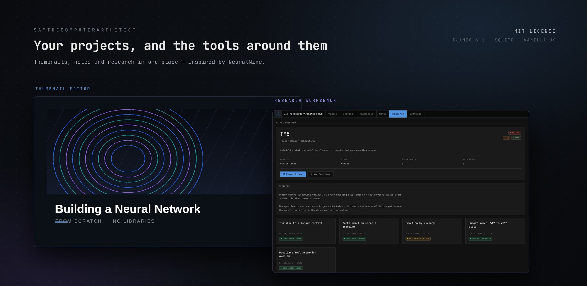
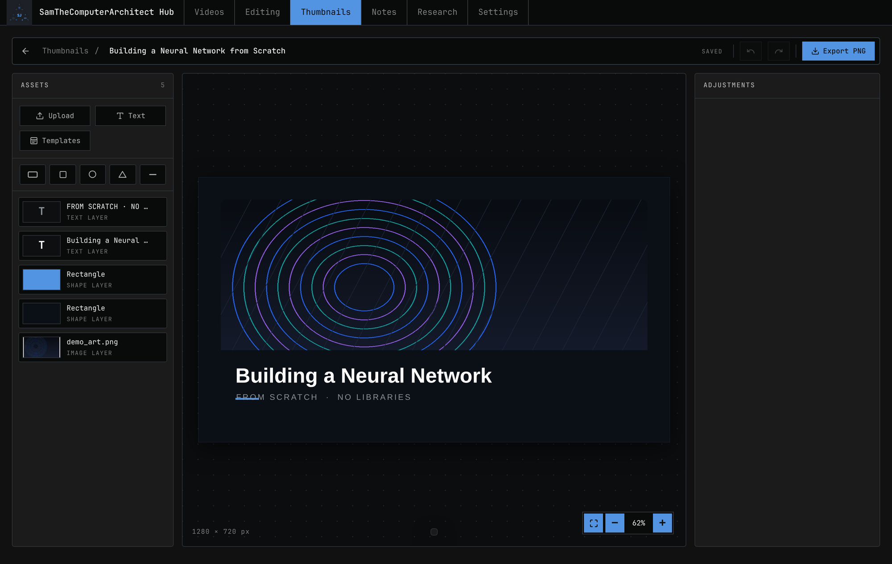
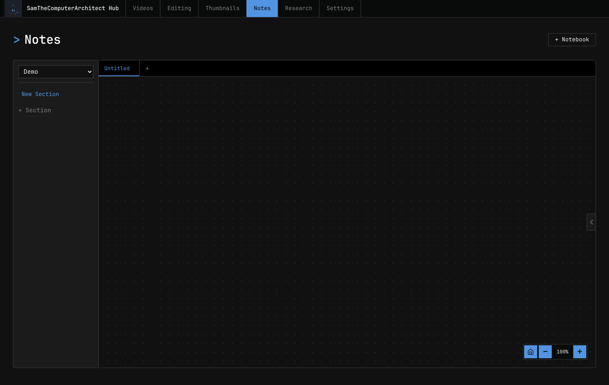
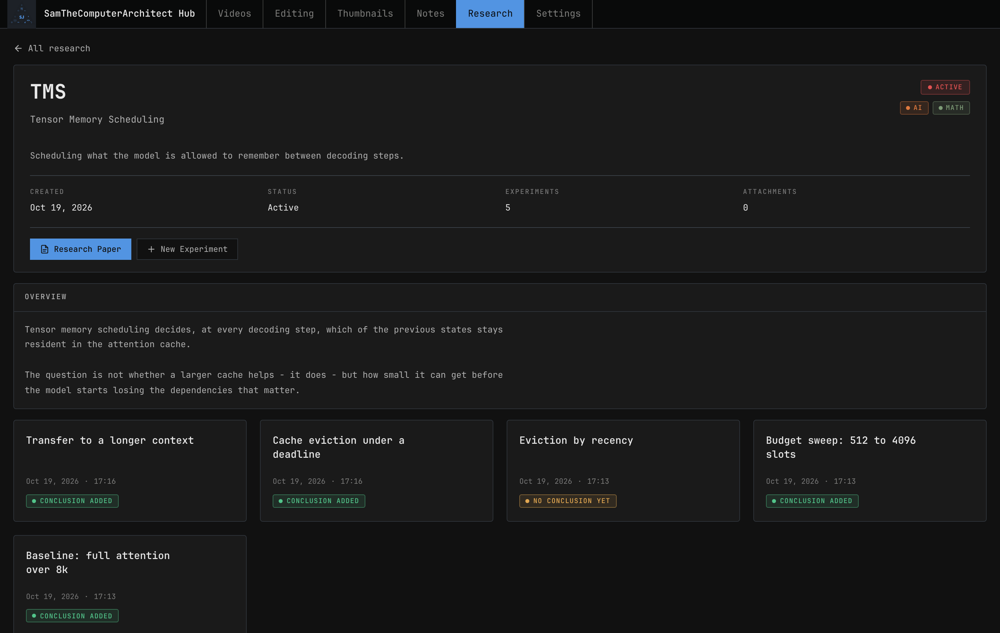

<div align="center">
  
</div>

# SamTheComputerArchitect Hub

[](https://www.python.org/)
[](https://www.djangoproject.com/)
[](LICENSE)
[](#tech-stack)

**A self-hosted workspace for your projects, with the tools around them built in.** Keep
everything in one place and reach for the tool you need without switching apps — a thumbnail
editor with snapping guides, a freeform notes canvas, a research workbench for hypotheses and
experiments, and more on the way.

Inspired by [NeuralNine](https://github.com/samTheComputerArchitect) and the way it works:
small, focused tools for each part of the work, one after another, all in the same place.
Some of it is original — the thumbnail editor renders its own PNG export in the browser and
matches the canvas exactly, and the research workbench treats a hypothesis and its conclusion
as two separate steps, with every card showing which one you are at.

| Tool | What it does |
| --- | --- |
| **Thumbnails** | A 1280 × 720 canvas editor: layers, snapping guides, shapes, text, image filters, undo/redo, PNG export. |
| **Notes** | An infinite canvas for ink, sticky notes, headings and images, organised into notebooks → sections → tabs. |
| **Research** | Projects with tags and statuses, live search, experiments with hypotheses, conclusions and file attachments — and a LaTeX **paper studio** that compiles and previews the paper next to the editor. |
| **Videos / Editing** | Placeholders for the next two parts of the workflow. |
| **Settings** | API key storage (Ollama Cloud today), a models panel and the editor preferences (vim mode, the `hjkl` motions). |

Everything runs locally on SQLite, with **no build step and no node_modules** — the front end
is hand written HTML, CSS and JavaScript served straight from `templates/` and `static/`.
The one third party piece, the CodeMirror editor, is vendored into `static/js/vendor/` so the
project still installs and runs with nothing but Python.

## Install

```bash
git clone https://github.com/samTheComputerArchitect/SamTheComputerArchitect-Hub.git
cd SamTheComputerArchitect-Hub

python3 -m venv .venv
source .venv/bin/activate          # Windows: .venv\Scripts\activate
python -m pip install "django>=6.1.2" "pillow>=13.0.0"

python manage.py migrate
python manage.py runserver
```

Then open <http://127.0.0.1:8000/>.

<details>
<summary>Prefer <code>uv</code>?</summary>

```bash
uv sync
uv run manage.py migrate
uv run manage.py runserver
```

</details>

## Getting started

```bash
python manage.py migrate            # create the database
python manage.py createsuperuser     # optional, for /admin/
python manage.py runserver           # http://127.0.0.1:8000/
```

## The tools

### Thumbnails

<div align="center">
  
</div>

A canvas editor that lives in the browser and talks to Django over a small JSON API.

- **Three kinds of element** — images, text and shapes (rectangle, square, circle, triangle, line).
- **Direct manipulation** — drag to move, eight handles to resize, a handle to rotate, arrow
  keys to nudge (1 px, or 10 px with <kbd>Shift</kbd>).
- **Snapping** — to canvas edges, to the centre, and to other elements, with live guides. Hold
  <kbd>Alt</kbd> to switch it off. There is also equal-gap spacing, so three elements can be
  lined up with exactly the same distance between them.
- **Layer ordering** — bring to front, send to back, and the z-order survives a reload.
- **Per-type properties**
  - *Text* — font family, size, letter spacing, bold, italic, alignment, fill and outline.
  - *Shapes* — fill or no fill, outline colour, outline width, corner radius, thickness.
  - *Images* — brightness, contrast, saturation, hue and corner radius.
- **Undo / redo** — 40 steps of full document snapshots.
- **Templates** — load a designed layout and keep editing it.
- **PNG export** — rendered in the browser from the same geometry the canvas uses, so the file
  matches what you saw.
- **Autosave** — every edit is persisted in the background, and anything still pending is
  flushed if you close the tab.

### Notes

<div align="center">
  
</div>

- Notebooks → sections → tabs, with the pan position remembered per tab.
- Freehand ink drawing with a configurable brush colour and width.
- Sticky notes and headings (`h1`, `h2`, `h3`) placed from a right-click menu.
- Images dropped or pasted onto the canvas, with resize and rotate handles.
- Pan and zoom, with a grid that stays glued to the content.

### Research

<div align="center">
  
</div>

- **Projects** with an acronym, a full form, a short description and a long write-up.
- **Tags** (AI, Math, Software, Other) and **statuses** (Active, Paused, Finished), each with
  its own colour, stored in the database so you can restyle them from the admin.
- **Live search and filtering** — the grid updates as you type, with no page reload and no
  query string in the address bar. Tags and statuses compose with the search.
- **A page per project** — a compact hero, the experiments as a card grid and the long
  write-up in a sticky sidebar.
- **Experiments** — title, description and hypothesis when you create it, and the conclusion
  afterwards, once the experiment has actually run. Every card says which state it is in.
- **A page per experiment** — clicking a card opens a read-only view with everything the
  experiment holds: what was done, what was expected, what happened, the dates and the
  files. The *Edit* button still opens the full form, and the conclusion page stays the
  place where the result is written down.
- **File attachments** — up to 25 MB each (100 MB per submit) from a fixed list of types
  (pdf, txt, md, csv, json, log, py, ipynb, images, archives, office documents, audio and
  video), removable later.
- **A file viewer** — click a file and it opens in a read-only code editor with syntax
  highlighting for code files, line numbers and the theme's own colours. Files that are not
  valid UTF-8 (a picture, an archive) say so instead of pretending to be text, and a file
  over 512 KB is shown truncated. Every file has a download button of its own.
- **A research paper page** per project — the paper studio, see below.

### The paper studio

Each project has a LaTeX paper that lives next to the work. The left side is the source, the
right side is the compiled PDF, and the two talk to each other.

- **A real editor** — CodeMirror with LaTeX syntax highlighting, line numbers, and the
  project theme.
- **Autosave and compile** — 1.5 s after you stop typing the source is saved and compiled;
  the PDF replaces the preview as soon as it is ready, and the error list points at the
  line that broke.
- **Real LaTeX** — the source is compiled with `lualatex` (so Greek letters, dashes and
  non-latin scripts work) and falls back to `pdflatex`. The run is sandboxed in a throwaway
  directory, shell escapes are off and it is capped at 25 seconds.
- **Vim mode** — optional, switched on in *Settings → Editor*. Normal, insert and visual
  modes with the full keymap, a `jk` chord that leaves insert mode, and a `jkl;` scheme
  that can replace the standard `hjkl` motions.
- **The system clipboard** — `"+y` yanks to it, `"+p` pastes from it.
- **Ex commands** — `:w` saves and compiles, `:q` goes back to the project, `:wq` does
  both.

## Keyboard shortcuts

### Thumbnail editor

| Action | Shortcut |
| --- | --- |
| Undo | <kbd>Ctrl</kbd>+<kbd>Z</kbd> |
| Redo | <kbd>Ctrl</kbd>+<kbd>Shift</kbd>+<kbd>Z</kbd> |
| Duplicate the selection | <kbd>Ctrl</kbd>+<kbd>D</kbd> |
| Delete the selection | <kbd>Del</kbd> |
| Rename the thumbnail | Double-click the title |
| Add text at a point | Double-click the canvas |
| Nudge by 1 px / 10 px | Arrow keys / <kbd>Shift</kbd>+arrows |
| Pan the canvas | Middle-drag |
| Disable snapping | Hold <kbd>Alt</kbd> |
| Paste an image | <kbd>Ctrl</kbd>+<kbd>V</kbd> |
| Snap rotation to 15° | <kbd>Shift</kbd> while rotating |
| Export a PNG | <kbd>Ctrl</kbd>+<kbd>E</kbd> |
| Zoom to fit | <kbd>Ctrl</kbd>+<kbd>0</kbd> |

### Paper editor (vim mode)

| Action | Shortcut |
| --- | --- |
| Leave insert mode | <kbd>j</kbd> then <kbd>k</kbd> |
| Save and compile | `:w` |
| Back to the project | `:q` |
| Save and leave | `:wq` |
| Yank to the system clipboard | `"+y` |
| Paste from the system clipboard | `"+p` |
| Save and compile | <kbd>Ctrl</kbd>+<kbd>Enter</kbd> |

## Configuration

Everything lives in `SamTheComputerArchitectHub/settings.py`.

| Setting | Default | Notes |
| --- | --- | --- |
| `SECRET_KEY` | dev placeholder | Change this before deploying — it signs sessions and CSRF tokens. |
| `DEBUG` | `True` | Set to `False` in production. |
| `ALLOWED_HOSTS` | `[]` | Add your domain, e.g. `["hub.example.com"]`. |
| `DATABASES` | SQLite file | Swap for Postgres or MySQL when you outgrow it. |
| `STATIC_URL` / `STATICFILES_DIRS` | `static/` | Where the CSS, JS and images live. |
| `MEDIA_URL` / `MEDIA_ROOT` | `/media/`, `media/` | Where uploads are stored. |
| `DATA_UPLOAD_MAX_MEMORY_SIZE` | 12 MB | The notes canvas posts pictures as base64 data urls (6 MB each) and the paper editor posts the whole source, so the body limit has to be above the app's own limits. |

For production, run `python manage.py collectstatic` and serve `staticfiles/` and `media/`
from your web server.

## Tech stack

| | |
| --- | --- |
| **Language** | Python 3.12+ |
| **Framework** | Django 6.1 |
| **Imaging** | Pillow 13 — server side sizing and upload validation |
| **Database** | SQLite by default |
| **Front end** | Vanilla HTML, CSS and JavaScript. No bundler, no framework, no CDN. |
| **Editor** | CodeMirror 5.65 — vendored in `static/js/vendor/codemirror/`, with the modes for LaTeX, Python, JavaScript, JSON, CSS, HTML, Markdown, SQL, shell, YAML and more |
| **Theming** | One dark theme built on CSS custom properties in `templates/base.html` |

## Layout

```
SamTheComputerArchitect-Hub/
├── SamTheComputerArchitectHub/   # Django project: settings, urls, wsgi, asgi
├── main/                         # Home page
├── notes/                        # Notes app
├── videos/                       # Videos page
├── editing/                      # Editing page
├── thumbnails/                   # Thumbnail editor
├── research/                     # Research app
│   ├── migrations/               # …and the ResearchPaper model (0008)
│   └── templatetags/             # truncate_chars, get_item
├── settings/                     # Settings app (API keys, editor preferences)
│   └── migrations/               # …and the EditorSetting model (0002)
├── templates/                    # Every page, one folder per app
│   ├── base.html                 # The theme: nav, modal, CSS variables
│   ├── research/                 # research, detail, experiment, experiment_form,
│   │                             # experiment_view, experiment_file, paper
│   ├── notes/                    # The notes canvas
│   ├── settings/                 # The settings pages
│   └── thumbnails/               # thumbnails, editor
├── static/
│   ├── js/research-common.js     # Shared modals for the research pages
│   ├── js/vendor/codemirror/     # The vendored editor and its syntax modes
│   └── Logo.png
├── docs/                         # Images used in this README
├── media/                        # Uploads (git ignored)
├── UI_UX_REDESIGN_REPORT.md      # Notes on the research app redesign
├── manage.py
└── pyproject.toml
```

## Development

```bash
git clone https://github.com/samTheComputerArchitect/SamTheComputerArchitect-Hub.git
cd SamTheComputerArchitect-Hub

python3 -m venv .venv && source .venv/bin/activate
python -m pip install "django>=6.1.2" "pillow>=13.0.0"

python manage.py migrate
python manage.py runserver
```

The dev server reloads on changes to the Python code. Django 6.1 caches the compiled
templates, so **a changed template needs a restart** — `touch research/views.py` is enough to
make the server pick it up again.

`python manage.py test` runs the suite — 269 tests covering the thumbnail API (element CRUD,
uploads, colour validation, ownership), the notes API, the research pages (search, filters,
the experiment workflow, the paper studio, the file viewer) and the settings. Every fix that
went in came with a regression test that pins it.

Pull requests are welcome. Keep the front end dependency-free — if it can be done in plain
JavaScript, it should be — and match the existing style: the theme lives in
`templates/base.html`, and every app keeps its own styles in its own template.

## License

MIT — see [LICENSE](LICENSE).

## Acknowledgements

[NeuralNine](https://github.com/samTheComputerArchitect) for the original idea of building
small, focused tools for every part of the creative process, and for the workflow this is
built around.
